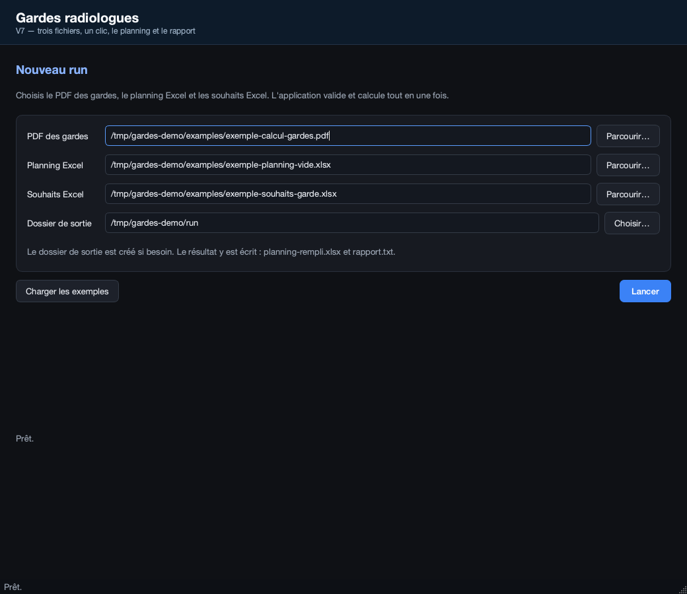
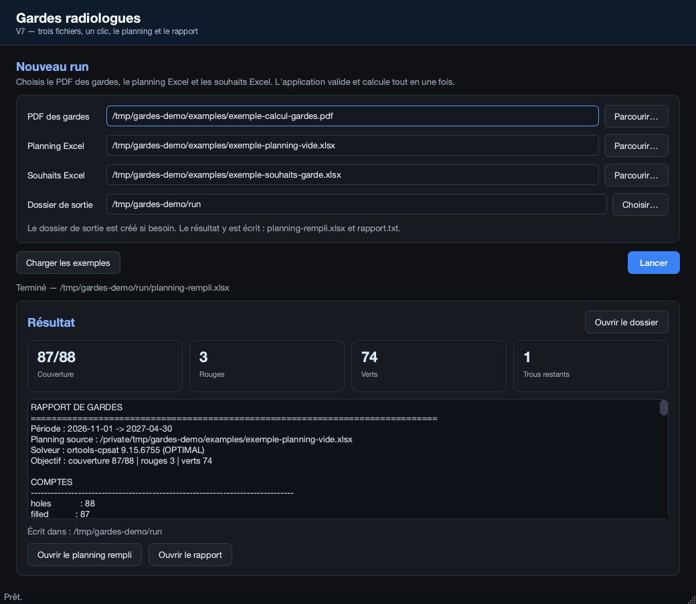

# RAD Gardes Automator — V7

Application locale d'attribution automatique des gardes de radiologues.
**V7 conserve le moteur complet de la V4** (étapes 1 à 5, solveur CP-SAT,
interface PySide6 sombre) mais remplace les six écrans de la V6 par **un seul
écran** : trois fichiers, un dossier de sortie, un bouton « Lancer ».

La V6 reste disponible au tag `v6.0.0` ; la V5 simplifiée reste abandonnée
(tags `v5.0.x`).

## Le flux V7

1. Choisir le **PDF des gardes**, le **planning Excel** et les **souhaits Excel**.
2. Vérifier le **dossier de sortie** (proposé par défaut :
   `~/Documents/RAD Gardes Automator/run`).
3. Cliquer sur **« Lancer »**.
4. Lire le **rapport** à l'écran et ouvrir le **planning rempli** ou le dossier.

Il n'y a plus d'étapes intermédiaires ni de validation manuelle : le planning
est scanné, le PDF est validé, les souhaits sont lus, l'attribution est
calculée et les fichiers sont écrits en une seule opération. En cas de donnée
incohérente, un message explicite indique quoi corriger.

## Sorties

Dans le dossier de sortie, **deux fichiers seulement** :

- `planning-rempli.xlsx` — le planning avec les gardes attribuées ;
- `rapport.txt` — le rapport complet (couverture, affectations, trous, quotas).

Les JSON intermédiaires de la V6 ne sont plus écrits par l'application.

## Applications macOS et Windows

Chaque release GitHub contient deux archives :

| Plateforme | Archive | Lancement |
|---|---|---|
| macOS Apple Silicon | `RAD-Gardes-V7-macos-arm64.zip` | décompresser, ouvrir `RAD Gardes V7.app` |
| Windows x64 | `RAD-Gardes-V7-windows-x64.zip` | décompresser, lancer `RAD Gardes V7.exe` |

Aucune installation de Python n'est nécessaire. Les exemples synthétiques sont
embarqués : bouton « Charger les exemples ».

- **macOS** : l'app est signée en ad-hoc. Au premier lancement, si macOS la
  bloque : clic droit sur l'app > « Ouvrir » > « Ouvrir ».
- **Windows** : version portable (`onedir`), à extraire où vous voulez.

## Prérequis (depuis les sources)

- Python 3.12
- `uv`
- macOS ou Linux avec affichage graphique

## Installation

```bash
uv venv .venv --python 3.12
UV_HTTP_TIMEOUT=900 uv pip install --python .venv/bin/python -e ".[dev]"
```

PySide6 Essentials 6.12.0 est la seule dépendance graphique. Le moteur utilise
openpyxl, pdfplumber et OR-Tools, installés avec le paquet `gardes`.

## Lancer l'interface

```bash
.venv/bin/python -m gardes_gui
```

ou, si le script est installé :

```bash
.venv/bin/gardes-gui
```

## Exemples fournis

Les fichiers de `examples/` sont des données de démonstration anonymisées,
cohérentes entre elles. Ils sont embarqués dans les applications.

| Fichier | Contenu |
|---|---|
| `exemple-calcul-gardes.pdf` | PDF de calcul : 30 lignes, 26 CDC, 3 urgentistes, 1 exclu |
| `exemple-planning-vide.xlsx` | Planning de départ : `Feuille1`, 181 jours, 88 trous, 24 pré-remplis |
| `exemple-souhaits-garde.xlsx` | Souhaits : 14 personnes, 181 dates |

Résultat attendu : **87/88**, **3 rouges**, **74 verts**, **1 trou férié**
(`2027-01-02` soir), 24 fixes préservés.

Voir `examples/README.md` pour le détail de l'anonymisation.

## Aperçu

| Avant le calcul | Résultat |
|---|---|
|  |  |

Captures générées en mode `offscreen` à partir des exemples anonymisés :

```bash
make screenshots
```

## Construire les applications

Le même spec PyInstaller construit l'app macOS et le dossier Windows :
`packaging/rad_gardes_v7.spec`. Il embarque le moteur, l'interface, PySide6,
OR-Tools, pdfplumber et `examples/`.

### macOS

```bash
packaging/build-macos.sh
```

Produit `dist/RAD Gardes V7.app` et
`dist/RAD-Gardes-V7-macos-arm64.zip`. L'archive est créée avec `ditto` pour
préserver les liens symboliques des frameworks Qt.

### Windows

```powershell
packaging\build-windows.ps1
```

Produit `dist\RAD Gardes V7\` et
`dist\RAD-Gardes-V7-windows-x64.zip`. Prérequis : Windows et Python 3.12.

Les deux builds exposent les options de vérification utilisées par la CI :

```bash
"RAD Gardes V7" --self-test    # pipeline complet sur les exemples, sans UI
"RAD Gardes V7" --smoke-test   # ouverture/fermeture de la fenêtre
```

## Tests

```bash
QT_QPA_PLATFORM=offscreen .venv/bin/pytest -q
```

La suite couvre le contrôleur (pipeline complet, validation des crédits), le
nouvel écran unique, le thème sombre, les chemins source/onedir/onefile, le CLI
et les steps 1 à 5. La CI GitHub Actions exécute la même suite sur Ubuntu et sur
Windows (workflow de release).

## Structure

```text
rad-gardes-automator/
├── examples/                  # PDF + classeurs synthétiques
├── src/gardes/                # moteur : steps 1 à 5, CLI, validation
├── src/gardes_gui/            # écran unique PySide6
├── tests/                     # tests moteur + interface
├── scripts/                   # captures et entrée PyInstaller
├── docs/screenshots/          # aperçu README
├── packaging/                 # spec macOS/Windows, icônes, scripts, LISEZ-MOI
└── .github/workflows/         # CI + release V7 (Windows)
```

## Publier une release V7

```bash
git tag v7.0.0
git push origin v7.0.0
```

Le workflow `.github/workflows/release-v7.yml` construit l'application Windows
en `onedir`, exécute les tests puis le self-test et le smoke test, crée
l'archive ZIP et la publie dans la release GitHub.

L'application macOS se construit localement (les runners macOS ne sont pas
disponibles sur cette installation GitHub Actions), puis son archive est
ajoutée à la release :

```bash
packaging/build-macos.sh
gh release upload v7.0.0 dist/RAD-Gardes-V7-macos-arm64.zip
```

Le workflow peut aussi être lancé manuellement depuis l'onglet Actions ; dans
ce cas l'archive Windows est disponible comme artifact, sans création de
release.

## Limites V7

- macOS fourni pour Apple Silicon (`arm64`) uniquement ; pas d'universel.
- Pas d'exécutable onefile ; la version Windows est fournie en `onedir`.
- Pas de signature Windows/macOS ni de notarisation.
- Pas de round suivant : chaque période repart des trois documents de référence.
- Pas de version été.
- Le PDF et le planning sont calés sur le format des exemples fournis.

Voir `STATUS.md` pour l'état du build et la reprise.

## Ligne de commande

Le moteur reste utilisable sans interface :

```bash
.venv/bin/gardes run --pdf examples/exemple-calcul-gardes.pdf \
  --planning examples/exemple-planning-vide.xlsx \
  --wishes examples/exemple-souhaits-garde.xlsx \
  --workdir data/run --auto-validate
```

## Licence

MIT — voir [`LICENSE`](LICENSE).

Les composants tiers embarqués dans les archives sont listés dans
[`THIRD_PARTY_NOTICES.md`](THIRD_PARTY_NOTICES.md). Toutes les dépendances du
moteur sont sous licence permissive (MIT, BSD, Apache-2.0) : l'extraction PDF
utilise `pdfplumber` depuis la version 4.0.1, PyMuPDF (AGPL-3.0) ayant été
retiré pour que les exécutables puissent être distribués sous MIT. Seul
PySide6/Qt est sous LGPL-3.0, utilisé non modifié et livré en bibliothèques
remplaçables.
