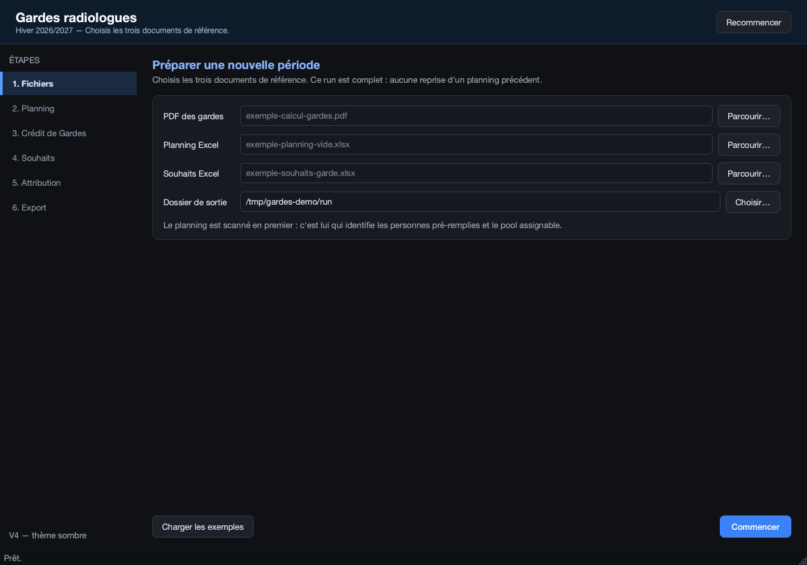
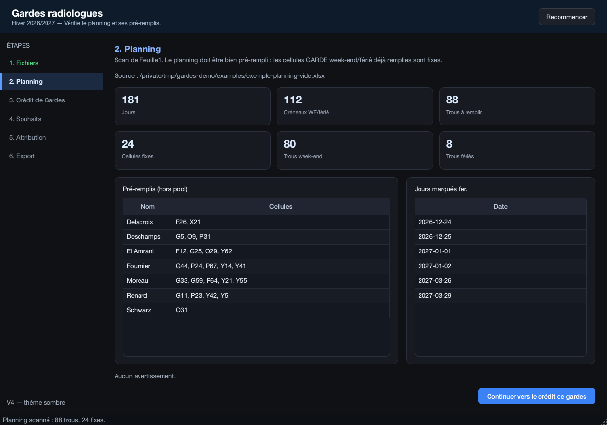
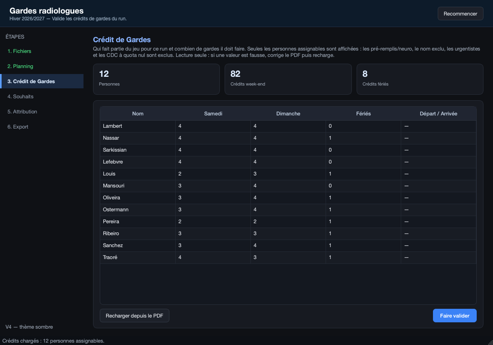
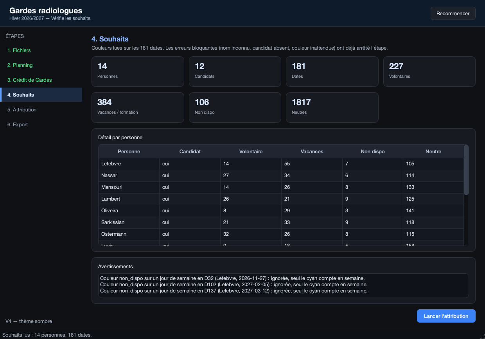
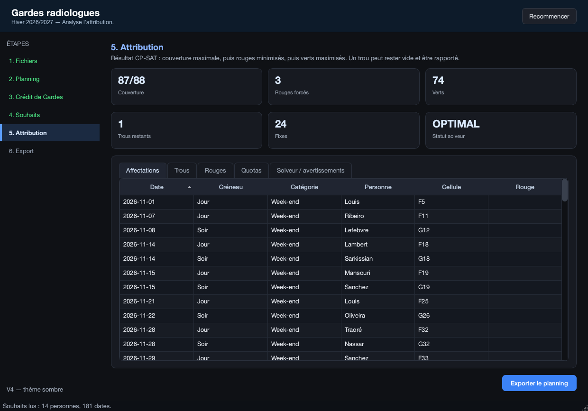
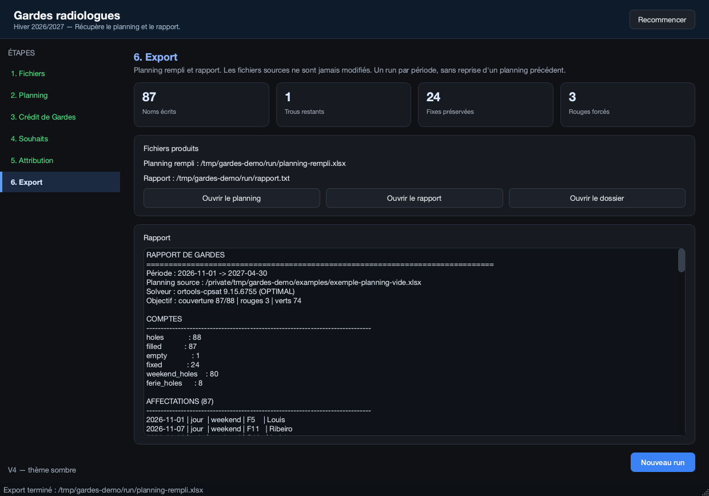

# RAD Gardes Automator — V4

Application locale d'attribution automatique des gardes de radiologues.
Le moteur (étapes 1 à 5) et l'interface PySide6 sombre sont dans le même
dépôt. L'application se lance depuis les sources sur macOS/Linux ; une version
Windows portable (`onedir`) est publiée dans les releases GitHub.

**V4 est prête à être publiée sur GitHub** : les trois documents d'exemple
sont entièrement synthétiques, sans nom réel, sans feuille morte, sans zone de
texte résiduelle et sans métadonnée nominative. Voir
[`examples/README.md`](examples/README.md).

Périmètre verrouillé :

- un run complet par période ;
- relance tous les 6 mois à partir des nouveaux documents de référence ;
- **pas de reprise d'un planning précédent** (« round suivant » hors V4) ;
- le moteur est intégré dans `src/gardes/`, sans duplication.

## Prérequis

- Python 3.12
- `uv`
- macOS ou Linux avec affichage graphique

## Installation

```bash
uv venv .venv --python 3.12
UV_HTTP_TIMEOUT=900 uv pip install --python .venv/bin/python -e ".[dev]"
```

PySide6 Essentials 6.12.0 est la seule dépendance graphique. Le moteur utilise
openpyxl, pdfplumber et OR-Tools, installés avec le paquet `gardes`.

## Lancer l'interface

```bash
.venv/bin/python -m gardes_gui
```

ou, si le script est installé :

```bash
.venv/bin/gardes-gui
```

## Application Windows portable

Les releases GitHub contiennent l'archive
`RAD-Gardes-Automator-windows-x64.zip` :

1. télécharger l'archive depuis la dernière release ;
2. l'extraire dans un dossier ;
3. lancer `RAD-Gardes-Automator.exe`.

Aucune installation de Python n'est nécessaire. Les fichiers produits sont
écrits par défaut dans `Documents/RAD Gardes Automator/run`.

## Parcours

| Écran | Rôle |
|---|---|
| **1. Fichiers** | PDF des gardes, planning Excel, souhaits Excel, dossier de sortie |
| **2. Planning** | Scan de `Feuille1` : 181 jours, 112 créneaux, 88 trous, 24 fixes, 80 WE, 8 fériés |
| **3. Crédit de Gardes** | 12 personnes assignables, `Samedi` / `Dimanche` / `Fériés` + `Départ / Arrivée`, lecture seule |
| **4. Souhaits** | 14 personnes, 181 dates, volontaires/vacances/non dispo, avertissements |
| **5. Attribution** | CP-SAT : couverture, rouges, verts, affectations, trous, quotas |
| **6. Export** | `planning-rempli.xlsx` + `rapport.txt`, ouverture des fichiers |

Le planning est scanné **avant** le crédit de gardes : c'est lui qui identifie
les personnes pré-remplies et le pool assignable.

## Exemples fournis

Les fichiers de `examples/` sont des données de démonstration anonymisées.
Ils sont cohérents entre eux : les noms du PDF, du planning et des souhaits
correspondent exactement.

| Fichier | Contenu |
|---|---|
| `exemple-calcul-gardes.pdf` | PDF de calcul : 30 lignes, 26 CDC, 3 urgentistes, 1 exclu |
| `exemple-planning-vide.xlsx` | Planning de départ : `Feuille1`, 181 jours, 88 trous, 24 pré-remplis |
| `exemple-souhaits-garde.xlsx` | Souhaits : 14 personnes, 181 dates |

Référence sur ces exemples : **87/88**, **3 rouges**, **74 verts**,
**1 trou férié** (`2027-01-02` soir), 24 fixes préservés.

### Anonymisation

- Tous les noms de personnes sont remplacés par des noms fictifs plausibles.
- Les feuilles internes inutilisées et les feuilles vides ont été supprimées
  des classeurs.
- Les zones de texte, images, hyperliens, paramètres d'imprimante et vues
  personnalisées ont été retirés.
- Les métadonnées nominatives, le logo et les initiales du PDF ont été
  supprimés ou remplacés.
- Les noms fictifs sont les mêmes dans les trois documents, pour que le
  pipeline reste exécutable de bout en bout.

## Thème sombre

- Fond `#0f1115`, cartes `#171a21`, bordures `#2a303c`.
- Texte `#e6e9ef`, texte secondaire `#9aa4b2`.
- Accent bleu `#3b82f6` / `#5b9dff`.
- Tableaux, en-têtes, onglets, scrollbars, tooltips et champs stylés.
- `QMessageBox`, `QDialog` et `QFileDialog` sont thémés ; les sélecteurs de
  fichiers utilisent le dialogue Qt (`DontUseNativeDialog`) pour rester sombres.
- Palette Qt sombre appliquée via `QPalette` + feuille de style.

## Aperçu

Captures générées en mode `offscreen` à partir des exemples anonymisés.

| Fichiers | Planning |
|---|---|
|  |  |

| Crédit de Gardes | Souhaits |
|---|---|
|  |  |

| Attribution | Export |
|---|---|
|  |  |

Pour les régénérer :

```bash
make screenshots
```

### Crédit de Gardes — lecture seule

- L'écran affiche **uniquement les personnes qui seront placées dans le run** :
  les 12 assignables.
- Sont exclus : les pré-remplis/neuro, le nom exclu, les urgentistes et les CDC
  à quota week-end/férié nul.
- Colonnes : `Nom`, `Samedi`, `Dimanche`, `Fériés`, `Départ / Arrivée`.
- Aucune édition : si une valeur est fausse, la secrétaire corrige le PDF puis
  clique sur « Recharger depuis le PDF ».
- « Faire valider » enregistre `calcul-gardes.json` avec `validated = true`,
  puis scanne les souhaits.
- Sur l'exemple, la colonne `Départ / Arrivée` vaut `—` pour les 12 personnes :
  les notes de dates du PDF concernent des personnes exclues du pool.

Les noms sont comparés **exactement** (casse, accents, espaces). Une typo dans
le planning ou dans les souhaits bloque l'étape avec un message explicite.

### Couleurs des souhaits

- Vert `FF00FF00` = volontaire, cyan `FF00FFFF` = vacances/formation, rouge
  `FFFF0000` = non dispo.
- Neutres : fond de ligne, blanc, gris, `none`, `theme0`.
- **Toute autre couleur est bloquante**, même sur une personne non candidate.
  Le message liste les cellules, la personne, la date, le RGB et les couleurs
  autorisées. L'utilisateur corrige le fichier des souhaits puis relance.
- Rouge/vert sur un jour de semaine : warning (couleur reconnue mais hors scope).

## Sorties

Dans le dossier choisi (par défaut `data/run`) :

- `gardes-a-remplir.json`
- `calcul-gardes.json`
- `souhaits-gardes.json`
- `attribution-gardes.json`
- `planning-rempli.xlsx`
- `rapport.txt`

## Tests

```bash
QT_QPA_PLATFORM=offscreen .venv/bin/pytest -q
```

La suite V4 (**51 tests** : 7 GUI + 4 chemins + 40 moteur) couvre le
contrôleur (pipeline complet, validation des crédits), un smoke test Qt qui
parcourt les six écrans en mode `offscreen`, un test du thème sombre, les
chemins source/onedir/onefile, le CLI et les steps 1 à 5.
La CI GitHub Actions exécute la même suite sur Ubuntu.

## Structure

```text
rad-gardes-automator/
├── examples/                  # PDF + classeurs synthétiques
├── src/gardes/                # moteur : steps 1 à 5, CLI, validation
├── src/gardes_gui/            # interface PySide6
├── tests/                     # 51 tests
├── scripts/                   # captures et entrée PyInstaller
├── docs/screenshots/          # aperçu README
├── rad-gardes-automator.spec  # build Windows onedir
└── .github/workflows/         # CI + release Windows
```

## Publier sur GitHub

Le dépôt local est déjà initialisé sur la branche `main`. Pour créer le dépôt
distant public et pousser :

```bash
gh repo create rad-gardes-automator --public --source=. --remote=origin --push
```

Avant de publier, vérifier qu'aucun fichier réel n'a été ajouté dans
`examples/` et que `data/` reste ignoré par Git.

### Release Windows

Le workflow `.github/workflows/release-windows.yml` construit l'application
Windows en `onedir`, exécute un self-test du pipeline et un smoke test de
l'interface, crée l'archive ZIP et la publie dans la release GitHub.

Pour déclencher une release :

```bash
git tag v4.0.1
git push origin v4.0.1
```

Le workflow peut aussi être lancé manuellement depuis l'onglet Actions ; dans
ce cas l'archive est disponible comme artifact, sans création de release.

## Limites V4

- Pas d'exécutable onefile ; la version Windows est fournie en `onedir`.
- Pas de signature Windows/macOS.
- Pas de round suivant : chaque période repart des trois documents de référence.
- Pas de version été.
- Le PDF et le planning sont calés sur le format des exemples fournis.

Voir `STATUS.md` pour l'état du build et la reprise.

## Licence

MIT — voir [`LICENSE`](LICENSE).

Les composants tiers embarqués dans l'archive Windows sont listés dans
[`THIRD_PARTY_NOTICES.md`](THIRD_PARTY_NOTICES.md). Toutes les dépendances du
moteur sont sous licence permissive (MIT, BSD, Apache-2.0) : l'extraction PDF
utilise `pdfplumber` depuis la version 4.0.1, PyMuPDF (AGPL-3.0) ayant été
retiré pour que l'exécutable puisse être distribué sous MIT. Seul PySide6/Qt
est sous LGPL-3.0, utilisé non modifié et livré en DLL remplaçables.
